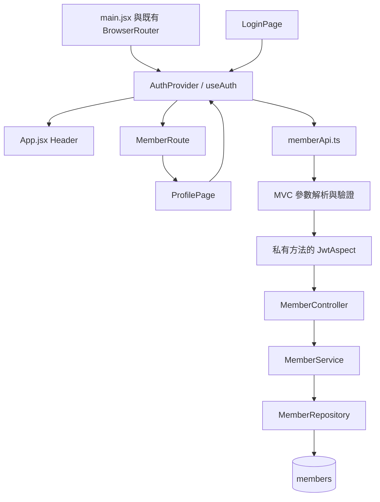

# 會員系統技術與學習報告

日期：2026-10-28（台灣時間）。本報告依副本最後程式撰寫，範圍限會員，不代表整站購物流程完成。

## 1. 完成範圍與現況

原專案為 `D:\giant\PhoneCase.project`，本次所有變更位於 `C:\Users\User\Documents\ChatGPT\develop\phonecase-member`。以 Git bundle 讀取原本歷史並 clone 成獨立 repository，沒有共用工作樹或修改原專案的 refs。重新 fetch GitHub 後，遠端 develop 與本地基底同為 `bbb9bfe49e81e1f0b1b75670d6f72c3fcbfdc528`；在 `codex/member-system` 開發，沒有提交或發佈。

| 類別 | 現況 |
|---|---|
| 原有 | React 註冊驗證、登入密碼切換、BCrypt、JWT、AOP、GET /me、Controller → Service → Repository、會員例外優先順序 |
| AI 新增 | AuthProvider、useAuth、MemberRoute、會員 API Service、PATCH DTO 與更新方法、會員中心、隔離測試、兩份報告與驗收腳本 |
| AI 修改 | 登入頁改用共用狀態與導頁、/me 及登入回傳完整安全欄位、Service 再檢查狀態、共用入口與 Header 接線、註冊頁移除重複 Header、會員 CSS 限縮作用域 |
| 已通過 | 前端 build、TypeScript、會員範圍 ESLint、後端乾淨編譯、MockMvc + 真實會員 AOP/API 測試、隔離 HTTP 服務上的瀏覽器核心操作 |
| 未驗證 | 真實 MySQL 持久化、實際部署 schema、正式 Spring Boot 全應用啟動、跨模組訂單與商品業務 |
| 暫不處理 | 忘記／變更密碼、變更 Email、刪除帳號、Refresh token、訂單 Session/JWT、全站管理員授權 |

資料庫操作：沒有連線、建表、匯入 SQL、更新共用資料。讀取 `backend/database/members.sql` 只為對照欄位上限。資料庫實際部署狀態尚待團隊確認。

偏離原先一般驗收方式的地方：因不能寫共用資料庫，採記憶體 Repository 隔離驗證；瀏覽器透過 test classpath 的 HTTP 橋接服務測試真實 Controller、驗證、AOP 與 Service。這不等於 JPA/MySQL 整合測試，不能宣稱正式資料庫驗收完成。

## 2. 架構與閱讀順序

畫面只負責顯示與輸入，Provider 記錄共用身分，Service 呼叫 HTTP。後端 Controller 接 HTTP，Service 決定業務與允許更新欄位，Repository 負責資料存取，Entity 對應資料表。DTO 則是外部輸入的邊界。



閱讀順序：`frontend/src/main.jsx` → `auth/AuthProvider.tsx` → `services/memberApi.ts` → `pages/member/LoginPage.tsx`、`ProfilePage.tsx` → `auth/MemberRoute.tsx` → `App.jsx`。後端先讀 `member/controller/MemberController.java`，接著 `dto/UpdateProfileRequest.java`、`service/MemberService.java`、`security/JwtAspect.java`、`JwtToken.java`、`repository/MemberRepository.java`、`entity/Member.java`。後端短路徑前綴皆為 `backend/src/main/java/com/phonecase/backend/`，前端短路徑前綴皆為 `frontend/src/`。

我應該能說出：前端的會員資料用來顯示，真正有權決定操作哪位會員的是後端驗證後的 id。

## 3. 實際流程與資料流

### 註冊

`RegisterPage.handleSubmit` 先擋重複提交及必填／格式錯誤，POST `/api/member/register`。MVC 將 JSON 轉成 `RegisterRequest` 並執行 Bean Validation；`MemberController.register` 交給 `MemberService.register`。Service trim 帳號／Email／姓名／電話，查重複 account、Email，檢查密碼 UTF-8 不超過 72 bytes，再 `BCrypt.hashpw(password, BCrypt.gensalt(12))`，儲存 CUSTOMER、ACTIVE 會員。成功回 201 與 memberId，不自動登入。前端僅在 HTTP 與 success 都成功時設定 registrationSuccess，顯示成功畫面、隱藏並停用表單，避免重複送出。Effect 設定 1500 毫秒計時器，再用 navigate("/login", { replace: true, state: { registrationSuccess: true } }) 導頁；也提供「立即前往登入」按鈕。離開頁面時 cleanup 會 clearTimeout，避免舊計時器把使用者帶回登入頁。不傳帳密。登入頁以 unknown 型別檢查成功標記，初始化訊息「註冊成功，請使用帳號與密碼登入。」。失敗仍留在註冊頁保留輸入與後端錯誤。資料庫唯一鍵競爭衝突由 handler 回 409。

### 登入與 JWT

`LoginPage.handleSubmit` 送 account 與原始 password，密碼不 trim。`useAuth().login` 呼叫 `memberApi.loginMember`；後端 `MemberService.login` 查 account，`BCrypt.checkpw` 核對，並拒絕非 ACTIVE 會員。`JwtToken.createToken` 以會員 id 字串做 subject，使用 HS256 簽章，有效一小時。

前端檢查回應結構後才把 token 寫進 localStorage、把 member 寫入 Provider，再導向 `/profile`。Header 同時更新。登入頁不再保留自己的會員狀態或測試登入介面。

### 刷新與私有 API

Provider 以 localStorage 的 token 決定初始 guest/checking；Effect 有 token 才發請求。初始沒 token 就是 guest；有 token 則呼叫 GET `/me`。`MemberRoute` 在 checking 時只顯示等待，不呈現個資；成功才 authenticated。401 清除 token 與會員，導向登入。403／500／網路錯誤進入 error，保留 token，顯示重試；無法確認時不呈現私有資料。

Spring MVC 先做 mapping、參數解析、JSON 轉換及驗證，再呼叫 Controller proxy。`@Before` 的 `JwtAspect.CheckJwt` 此時才檢查 Authorization、簽章、期限、subject、會員存在與 ACTIVE，並將 id 放入 `authenticatedMemberId`。最後進入 Controller 方法本體讀取 request attribute。因此不能用必填 `@RequestAttribute` 參數提早解析，否則切面尚未寫入就可能失敗。格式不正確的 PATCH 可能先回 400，不代表繞過授權；方法本體仍不會執行。

### 查看、修改、取消

`ProfilePage` 顯示 Provider 的會員資料，沿用原靜態 member/profile.html 的側欄與雙欄欄位布局，欄位會持續顯示；非編輯狀態下為 readOnly。密碼欄只顯示系統管理說明，不讀取或傳送 passwordHash。建立／更新時間因目前 API 未提供，明確顯示「暫未提供」；訂單側欄項目標示尚未整合且不可操作，不導向未接通的流程。按編輯才把資料複製到頁面輸入 state；按取消只退出編輯，不改 Provider、不送 API。按儲存先檢查姓名、電話、地址，再透過 Provider 呼叫 PATCH `/me`。Controller 從 request 取得身分，不從 body 接受 id。Service 再查會員與狀態、只更新三個允許欄位，以 transaction 保存。成功回完整安全欄位並更新 Provider，Header 立即顯示新姓名；失敗仍留在編輯模式，不清空輸入。

### 登出、過期、停權、網路失敗

登出清 localStorage、共用會員與錯誤，同時增加請求版本，私有頁回到登入頁。JWT 沒有伺服器黑名單，已簽發的 token 本身在到期前仍可能有效。過期或停權在下一次私有 API 驗證時得到 401。網路錯誤無法證明 token 已壞，因此不自動清除。已進行中的寫入可能在伺服器完成；登出能阻止舊回應恢復前端狀態，不能撤銷已送出的寫入。

我應該能說出：一次個資更新經過哪些層，以及 401 與伺服器故障對登入狀態的不同影響。

## 4. 檔案與變更對照

| 路徑 | 狀態、方法、原因與影響 |
|---|---|
| `frontend/src/main.jsx` | 修改：既有 BrowserRouter 內加 AuthProvider，保留 StrictMode 與單一 Router |
| `frontend/src/App.jsx` | 修改：Header 讀 useAuth，新增登入／註冊或會員中心／登出；只替 /profile 包 MemberRoute，其他 route 保留 |
| `frontend/src/auth/AuthProvider.tsx` | 新增：login、logout、retry、updateProfile、恢復 Effect；唯一共用身分狀態 |
| `frontend/src/auth/useAuth.ts` | 新增：Context、共用型別與 useAuth；配合現有 Fast Refresh 規則，與 Provider 元件分檔 |
| `frontend/src/auth/MemberRoute.tsx` | 新增：依 checking/error/guest/authenticated 決定等待、重試、導頁或內容 |
| `frontend/src/services/memberApi.ts` | 新增：loginMember/getCurrentMember/updateCurrentMember、MemberApiError、JSON 型別守衛 |
| `frontend/src/types/member.ts` | 修改：MemberInfo 完整欄位、ProfileUpdate 可省略欄位；保留原回應型別以減少破壞既有引用 |
| `frontend/src/pages/member/LoginPage.tsx` | 修改：表單只保留輸入、顯示密碼、提交與錯誤，成功導向 profile，移除失效忘記密碼連結及重複 Header |
| `frontend/src/pages/member/ProfilePage.tsx` | 修改：原空白頁成為實際可查看、編輯、取消、儲存與登出的會員中心 |
| `frontend/src/pages/member/RegisterPage.tsx` | 修改：保留原流程／驗證，頁面加作用域容器，移除重複 Header |
| `frontend/src/styles/member/login.css`、`register.css` | 修改：原規則包入 .member-login / .member-register；原 :root/body/#root 改套容器；media 規則仍在作用域內 |
| `frontend/src/styles/member/profile.css` | 修改：只作用於 .member-profile，改以原 member/profile.html 草圖為參考的灰色側欄、雙欄表單及手機單欄排版 |
| `backend/.../member/controller/MemberController.java` | 修改：memberData 白名單 Map、updateMe、新增 email/phone/defaultAddress，保留 success/member 外層及原欄位 |
| `backend/.../member/dto/UpdateProfileRequest.java` | 新增 record、驗證與 rejectUnknown，拒絕未授權欄位 |
| `backend/.../member/service/MemberService.java` | 修改 getCurrentMember：null／狀態檢查；新增 updateProfile：本人資料及三欄位 transaction |
| `backend/.../member/controller/MemberExceptionHandler.java` | 修改：JSON／未知欄位回 400；驗證訊息適用登入與個資；保留最高優先順序與限定 Controller |
| `backend/src/test/java/com/phonecase/backend/member/MemberApiTest.java` | 新增：四組 MockMvc、AOP 與 Service 隔離案例 |
| `backend/src/test/java/com/phonecase/backend/member/MemberBrowserServer.java` | 新增：僅 test classpath 的 loopback HTTP 橋接與故障注入，不會打包成正式業務 API |
| `docs/member/` | 新增：本報告、快速導覽、Start-MemberDemo.ps1 及驗證證據 |

Header 新連結允許換行並限制長姓名寬度，保留原網站導覽。App 的購物車 `getGuestCartCount`、cartUpdated/storage 事件與 cleanup 原樣保留。商品、購物車、結帳、訂單、後台路由仍在。未修改 pom、package、lockfile、Vite、application.properties、schema、SQL、其他組員業務或全域 CSS。

我應該能說出：共用檔只改了哪些接線，以及為什麼會員 CSS 不能再直接設定全站 body/input。

## 5. API 契約

所有 URL 都以 `/api/member` 為前綴，JSON。私有 API 需 `Authorization: Bearer <token>`。

| Method / path | JWT | 輸入 | 成功 | 常見失敗 |
|---|---|---|---|---|
| POST /register | 否 | account/password/name/phone/email，依 RegisterRequest 驗證 | 201，success/message/memberId | 400 驗證或重複，409 DB 約束 |
| POST /login | 否 | account/password | 200，success/message/token/member | 400 格式，401 帳密或停權 |
| GET /me | 是 | 無 body | 200，success/member | 401 token／會員失效 |
| PATCH /me | 是 | name/phone/defaultAddress，可省略 | 200，success/message/member | 400 JSON／未知欄位／驗證、401 身分、409 DB 約束 |

安全的 member 形狀：

```json
{"id":1,"account":"example","name":"範例會員","email":"example@example.com","phone":null,"defaultAddress":null}
```

錯誤回應通常為 `{"success":false,"message":"原因"}`；Bean Validation 另有 errors 物件，以欄位名對應訊息。未預期的後端故障可能由全域 handler 接手；前端仍依 HTTP 狀態處理，不假定所有錯誤一定是此格式。

更新語意明確如下：

| JSON | 行為 |
|---|---|
| `{}` 或欄位未提供 | 不更新該欄位 |
| `{"phone":null}`（name/address 同理） | 不更新；本版 null 與省略同義 |
| `{"phone":"","defaultAddress":""}` | 儲存為 SQL NULL，畫面顯示尚未設定 |
| `{"name":""}` 或全空白姓名 | 400，不可清空姓名 |
| `{"name":" 新姓名 "}` | 通過驗證後 trim 儲存 |
| `{"role":"ADMIN"}`、id/account/email/status/passwordHash 或其他未知鍵 | 400，不予忽略，也不更新 |

name 最長 80；phone 最長 30，非空時 7–15 位數字，可含開頭 + 與連字號；defaultAddress 最長 500。電話 API 使用格式驗證，單純空白不是合法電話，清空請送 `""`。前端先 trim 再送出。

前端註冊仍在 RegisterPage 直接呼叫；登入／GET／PATCH 集中於 memberApi，Provider 統一處理私有 API 的 401。403 顯示權限不足並保留狀態；目前會員私有端點沒有另設角色限制，主要拒絕結果是 401，403 行為是為後續串接及上游權限錯誤準備。

## 6. 資料庫欄位對應

| members | Entity / 前端 | 來源與規則 |
|---|---|---|
| id bigint | id / number | DB 自增，JWT subject；不可從更新表單決定 |
| account varchar(100) | account / string | 註冊輸入，唯一，個資第一版唯讀 |
| email varchar(255) | email / string | 註冊輸入，唯一，個資第一版唯讀 |
| password_hash varchar(255) | passwordHash / 不提供 | 後端 BCrypt；不回傳、不由個資 DTO 接收 |
| name varchar(80) | name / string | 註冊及更新輸入，必填 |
| phone varchar(30) nullable | phone / string 或 null | 註冊必填沿用原契約，個資可清空 |
| default_address varchar(500) nullable | defaultAddress / string 或 null | 個資可填及清空 |
| role/status varchar(20) | role/status / 不提供 | 後端管理；本次未新增角色管理功能 |
| created_at/updated_at | createdAt/updatedAt / 不提供 | MySQL DEFAULT/ON UPDATE，Entity insertable/updatable=false |

Entity 表達儲存資料；DTO 表達這次操作允許輸入的內容。若直接把 Entity 當 body，前端就可能提交 role/status 等不應修改的欄位。回傳也採 memberData 的六個安全欄位，不將 Entity 直接序列化。

Map.of 不接受 null，因此 memberData 使用 LinkedHashMap，允許 phone/defaultAddress 為 null。外層 success/member 都非 null，仍沿用 Map.of。Entity 保留 Lombok Getter/Setter/NoArgsConstructor，沒有改成 Data。

我應該能說出：哪三個欄位能改，哪個欄位由 MySQL 管，以及 Entity 為什麼不適合直接傳給前端。

## 7. 安全與權限

BCrypt.gensalt(12) 產生含成本的隨機 salt，hashpw 建立儲存雜湊，checkpw 用原始密碼和既存雜湊驗證。每次 salt 不同，所以不能重算一次再用字串相等比較。密碼不 trim，並限制 UTF-8 72 bytes，避免 BCrypt 的長度限制引起意外。

JWT 的 sub 是會員 id、iat 是簽發時間、exp 是一小時後。HS256 簽章驗證資料是否被竄改及是否由持有金鑰的一方簽發；不是加密，payload 可被解碼，所以不能放密碼。JwtToken.verifyToken 檢查簽章並要求期限及 subject，JwtAspect 再檢查正整數 id、會員存在及 ACTIVE。

身分驗證回答「你是誰」；角色授權回答「你能做什麼」；資料歸屬回答「這份資料是不是你的」。本次 `/me` 用已驗證 id 選會員，不接受 body id，保護本人資料；沒有將其他模組補成完整管理員角色授權。

localStorage 方便刷新保留，但可被同源腳本讀取，XSS 可能偷走 token。固定開發金鑰沿用原專案，僅供開發；正式部署前需外部機密管理、HTTPS、XSS 防護、金鑰輪替及登入節流等，並經團隊評估。這些不是本次已實作功能。登出只刪瀏覽器 token，沒有伺服器撤銷機制；帳號停權會在下一個私有 API 立刻被查出。

我應該能說出：驗證簽章不等於加密；清除 token 不等於撤銷所有已簽發 token。

## 8. React 狀態與時機

頁面自己的 state：account/password/showPassword、個資輸入、editing/saving/message。共用 state：currentMember、status、error，放 Provider，Header 與會員頁用 useAuth 讀同一份。

token 是驗證憑證，放 localStorage；currentMember 是畫面資料，放 React state。有 token 時仍不能直接設 authenticated，必須先 /me。localStorage.setItem 不會自行讓 React 重畫，所以登入與更新成功還要 setCurrentMember。

| 時機 | 共用狀態 |
|---|---|
| 首次掛載／刷新有 token | checking → /me → authenticated 或 guest/error |
| 首次掛載沒 token | 直接 guest |
| 登入成功 | 保存 token → member → authenticated → /profile |
| 個資成功 | member 更新；Header 與頁面一起顯示新資料 |
| 登出／私有 API 401 | 清 token/member → guest |
| /me 網路、500、403 | 保留 token，currentMember 不顯示，status=error，提供 retry |

初始狀態在 useState 的初始化函式決定，重試按鈕先設定 checking。Effect 的相依陣列只有 retryCount，首次及重試重新驗證，不會每次輸入都發 GET。cleanup 呼叫 AbortController.abort 中止恢復請求，並增加版本號。StrictMode 開發模式會做 setup/cleanup/setup，這樣舊請求不能寫回。

useRef(version) 是不需要顯示的「操作版本」。登入開始／登出／恢復 cleanup 會改版本；每個非同步操作保存開始時版本，回來先比對。假設 PATCH 等待中使用者按登出，版本已改，舊成功或 401 都不能蓋掉新狀態。AbortController 只負責取消恢復請求，版本號還涵蓋登入及更新，因此兩者各有用途。沒有導入 useMemo/useCallback/useReducer 或額外狀態管理。

我應該能說出：表單值為什麼不放共用 Context，以及晚到請求為什麼不能只靠 setState 順序解決。

## 9. 設計與複雜度決策

| 新觀念 | 解決眼前問題 | 與熟悉寫法對照、未採方案 |
|---|---|---|
| Context / Provider / useContext | Header、登入頁、會員頁共用狀態 | 原本 LoginPage 的 useState 搬到共同父層並提供方法；不引入 Redux 或全站框架 |
| useRef 版本號 | 非同步回應晚到覆蓋登出／新登入 | 像方法開始記錄流水號，回來核對；state 非同步更新不適合作即時版本鎖 |
| AbortController | Effect cleanup 取消無用的 /me | 比只有 active 旗標多了取消網路工作，仍保留版本處理其他操作 |
| unknown + 型別守衛 | 外部 JSON 不能只相信 TypeScript interface | 類似後端先檢查輸入再用；沒有用 any 或 as 略過資料問題 |
| MemberApiError | 分辨 401 與網路故障 | 一個小 Error 子類別保存 status；未做通用攔截器與 API 工廠 |
| record 更新 DTO、JsonAnySetter | 限制可修改三欄及拒絕多餘鍵 | 延續 RegisterRequest record；空值語意用字串規則，不加複雜 Optional 包裝 |
| Transactional | 一次更新的讀／改／存共用交易 | 相較單純 repository.save，讓 Service 宣告完整更新責任；測試替身不能驗證 DB rollback |
| CSS 巢狀作用域 | 會員 input/body 樣式曾污染整站 | 保留原規則包在會員容器，未改全域 CSS；動畫 keyframes 留在外層，屬原本命名且只由會員規則引用 |

沒有新增通用 BaseController/Service、Spring Security、Session 登入、Refresh token 或依賴。useAuth 與 Context 放在同一個 useAuth.ts，Provider 元件另檔，符合既有 Fast Refresh 檢查，沒有關閉 lint 規則。欄位回應沿用 Map，只有需要接受更新的 DTO 新增 record。PATCH 的 null 選擇不改，是為了用現有簡單 record 清楚表達；清空以空字串表示並在契約公開，不偷偷把省略欄位清掉。

建議先讀頁面如何呼叫 useAuth，再讀 Provider，最後讀型別守衛與競態，不必第一次就理解所有細節。正式部署前的工作包含隔離 DB 整合測試、金鑰與傳輸安全、Session/JWT 協調，以及團隊自己的管理員授權決策。

## 10. 測試與證據

實際環境：Windows、PowerShell、Node 24.19.0、現有 Vite 8.3.3、JDK 支援 release 21、Maven 3.9.16；使用副本自己的 node_modules（從來源複製），沒有安裝新測試依賴。

### 已執行命令

```powershell
# 位於副本 frontend
npm.cmd run build
.\node_modules\.bin\tsc.cmd --noEmit -p tsconfig.app.json
.\node_modules\.bin\eslint.cmd src/auth src/services/memberApi.ts src/pages/member src/types/member.ts

# 位於副本 backend，這次使用本機既有 Maven
& 'C:\Users\User\.m2\wrapper\dists\apache-maven-3.9.16-bin\5grr65jo27hi51sujmtcldfovl\apache-maven-3.9.16\bin\mvn.cmd' -o '-Dmaven.repo.local=C:\Users\User\.m2\repository' '-Dtest=MemberApiTest' clean test

# 位於副本根目錄
git diff --check
git status --short
```

前端 build、型別檢查及會員範圍 ESLint 通過。Maven 乾淨編譯 48 個正式 Java 檔，MemberApiTest 四組案例全部通過。測試證據為 `backend/target/surefire-reports/TEST-com.phonecase.backend.member.MemberApiTest.xml`，屬重跑會更新的忽略產物，不應提交。

首次沙箱讀 Maven 快取 spring-web JAR 權限失敗，改在使用者權限下重新 clean test 成功；先前失敗沒有當成通過。Mockito 顯示動態載入 Java agent 的未來 JDK 相容警告，這次沒有失敗。測試使用部分 Spring 已標記 deprecated 的 API，不影響目前測試結果。

### API 案例

| 測試方法 | 預期及實際結果 |
|---|---|
| registrationAndDuplicates | 201、BCrypt cost 12 可核對、重複 account/Email 400、空 body 欄位驗證 400：通過 |
| loginAndCurrentMemberContract | 正確帳密 200、有 JWT、會員安全欄位/null、錯誤帳密／不存在／停權 401：通過 |
| rejectsMissingMalformedTamperedExpiredAndInvalidIdentity | 無 Header、錯誤 prefix、空／垃圾／竄改／過期 token、不存在／停權會員 GET 與停權 PATCH 401：通過 |
| profileUpdateOwnershipValidationAndEmptyValues | 更新本人、另一會員不變、空字串清空、未提供／null 不改、姓名／電話／長度／JSON 錯誤 400、禁止欄位 400、無身分 PATCH 401：通過 |

MockMvc 會執行真實 Controller、Bean Validation、ExceptionHandler、Service、JWT 與 AspectJ proxy；Repository 是 Mockito 記憶體替身，Service 不是資料庫 transaction proxy，所以沒有證明 SQL、JPA query、rollback、DB 競爭衝突與持久化。

### HTTP 與瀏覽器

MemberBrowserServer 將同一套隔離 MockMvc 接到 `127.0.0.1:18080`，並提供前端 build。這是真正透過 HTTP 的瀏覽器 fetch，但伺服器內部是測試 DispatcherServlet，並非正式應用全組件啟動。其 `/__test/mode?...` 只存在 test classpath，正式專案沒有此路由。

瀏覽器已操作：未登入直接 /profile → /login、註冊成功與前往登入、錯誤密碼訊息、正確登入導向 profile、查看資料、姓名必填、更新姓名與 Header 同步、電話清空、地址儲存、刷新恢復、500 恢復失敗及重試成功、儲存 500 保留輸入、延遲 PATCH 後立即登出且舊回應不恢復會員、403 恢復錯誤保留重試、手機 390px 寬度檢查。其他補充驗證見同目錄的驗收證據檔。

已有的建置警告：`/images/caselab-hero-phonecases.png` 建置時無法解析，原本由後端執行期提供；本次沒有改商品圖片或修成假資產。測試服務對非會員 API 回 503，因此商品資料與訂單功能不能在這個服務驗收。既有其他模組的 @SpringBootTest 未執行，避免使用正式資料庫設定；沒有關閉 TypeScript 或修改測試來掩蓋它們。

### 自行重跑與故障注入

先執行快速導覽的 Start-MemberDemo.ps1，用虛構資料註冊並登入。測試服務資料只存在記憶體，每次重新啟動都要重新註冊。

```powershell
# 僅對隔離測試服務。先在瀏覽器登入，再切換模式並刷新 profile。
Invoke-RestMethod 'http://127.0.0.1:18080/__test/mode?restore500'
# 應顯示失敗與重試，改回正常再按重試應恢復。
Invoke-RestMethod 'http://127.0.0.1:18080/__test/mode?normal'
# 其他模式：restore403、expired、patch500、delayMe、delayPatch。
```

patch500：改姓名按儲存，應留住輸入；normal 後可重試。delayPatch：送出後三秒內按 Header 登出，應持續留在登入頁，即使伺服器已完成寫入。expired：刷新 /profile 應 401 清除登入，改 normal 再刷新也不能自動恢復。瀏覽器檢查重複送出時按鈕禁用；Header 購物車事件程式的 diff 應無變動。

真正 MySQL 驗收的前置條件：團隊提供明確隔離、可丟棄的本機資料庫，確認 schema 與連線，之後才可以測註冊持久化、唯一鍵衝突、資料庫時間戳與重啟後讀取。此次沒有自動修改 application.properties 或執行 SQL 取得這些條件。

## 11. 排查與小修改指南

400 先看 Network request body、response.errors、DTO 驗證，確認 phone 是清空 `""` 還是格式錯誤；未知欄位不能送。401 依序查 account/password、Bearer 的空格、token 期限與簽章、會員存在與 ACTIVE、AOP attribute。403 顯示權限不足，不應清 token；找該模組的角色規則。500 先查後端 log 與 DB 可用性，不把它解釋成帳密錯誤。

有 token 卻不能進：先看 /me HTTP 結果；只看 localStorage 不足。刷新掉狀態：確認 AuthProvider 在 Router 內且包住 App，先等待 checking；檢查 /api proxy 是不是連到真正後端。存檔失敗：看 PATCH body、三欄位長度、status、資料庫限制，網路重試前先確認前次是否已寫入，避免誤以為失敗一定沒有更新。

小修改範例：

1. 改登入按鈕文字：修改 LoginPage 的登入／登入中顯示字串，重跑 build 並確認禁用時機不變。
2. 改姓名上限：需先與 schema 協調，再改 UpdateProfileRequest 的 Size、ProfilePage maxLength 與前端條件，新增邊界測試；不是只改 HTML maxlength。
3. 改登入目的頁：LoginPage 的 navigate 與已登入 Navigate 都要一致，目標需既有路由；目前文件要求固定 /profile。
4. 增加顯示既有欄位：依 Entity → memberData → MemberInfo → isMember → ProfilePage 追蹤。若欄位可修改，還要 DTO、Service、驗證及資料庫授權，不能直接把全部 Entity 回傳。
5. 調整電話提示：前後端驗證 regex 與說明須一致；用空值、有效國碼、太短、太長及非法字元重新測。

我應該能說出：看到 401 時先找哪個請求，而不是直接刪 token、改密碼或重寫整個表單。

## 12. 團隊交接

會員提供註冊、account 登入、JWT、GET/PATCH /me 及共用畫面狀態。其他前端需驗證 API 時，附 Bearer Header；不要把 Provider 的 id 當後端授權依據，也不要把開發 DevLogin 當正式登入。

```java
@CheckJwt
// 在 Controller 方法本體內，不使用必填 @RequestAttribute 參數
Long memberId = (Long) request.getAttribute("authenticatedMemberId");
```

組員端點仍需自行檢查資料歸屬，例如訂單查詢條件同時包含 orderId 與 authenticatedMemberId；只驗證 JWT 不會自動限制某份訂單只能由本人讀取。會員狀態由現有 AOP 查 DB，401 代表身分不可用；403 應用於已驗證但缺乏權限的操作。

| 待整合 | 建議負責者與前置條件 |
|---|---|
| 訂單 Session → JWT | 訂單組員：OrderController 改從驗證 attribute 取 id，orderApi 附 Bearer，補本人訂單限制與 401／403 測試 |
| 購物車／結帳識別 | 購物車與訂單組員：決定 guest cart、登入 cart 合併規格，再調整請求與資料歸屬 |
| 管理員權限 | 後台組員：定義角色矩陣並在後端驗證，不僅隱藏路由 |
| MySQL 驗收 | 團隊共同：隔離本機 DB、確認 schema、授權可寫測試資料後補持久化測試 |
| 正式金鑰與部署 | 團隊／部署負責者：外部金鑰、HTTPS 與環境設定；此次不部署 |

本次未修改 OrderController、orderApi.ts、DevLoginController、商品、購物車、結帳、金流與後台。會員中心沒有放尚未接通的訂單入口。會員 JWT 登入沒有另外建立 Session，因此不能宣稱訂單登入已相容。

## 13. 我的理解與展示準備

原有程式來自本次基底，不能單靠 Git 路徑判斷每一行最初由哪位組員或 AI 撰寫。原有／本次 AI 協助新增與修改的邊界列於第 1、4 章。報告提供學習目標，沒有宣稱你已經理解或能獨立維護所有內容。

我應該能說出：Controller 不直接做密碼比較的分層理由；BCrypt 與 JWT 各自解決什麼；Provider 跟 localStorage 的差別；JWT id 如何用於本人資料；晚到回應如何被擋住；哪些跨模組功能尚未完成。

### 3～5 分鐘展示

1. 30 秒說明模組責任與限制：會員可用，訂單識別待整合。
2. 45 秒註冊及錯誤帳密：展示驗證與後端訊息，說明密碼雜湊。
3. 45 秒登入至會員中心並刷新：展示共用狀態、JWT 與 /me。
4. 60 秒改姓名、清空電話、取消／儲存：展示 PATCH、Header 同步與允許欄位。
5. 30 秒登出並直接輸入 /profile：展示前端存取保護與後端獨立驗證。
6. 30 秒說明測試證據：build 不等於 API；隔離替身不等於 MySQL 持久化。

常見追問：為什麼用 Context？多個同層畫面需要同份會員狀態。為什麼 JWT 還查會員？確保不存在或停權能立即拒絕。前端傳別人的 id 怎麼辦？DTO 拒絕未知 id，實際使用 JWT id。怎麼處理網路失敗？保留 token，顯示 error/retry。登出是否撤銷 JWT？目前只清瀏覽器，沒有黑名單。

### 先作答，再往下看答案

1. token 存在但 /me 回 500，應該直接登出嗎？為什麼？
2. PATCH 只送 phone，姓名會不會消失？name=null 呢？
3. 為什麼不能用 @RequestAttribute 在 Controller 參數接 AOP 尚未寫入的值？
4. 若 PATCH 尚未回來就登出，版本號保護的是什麼？是否撤銷後端寫入？
5. 只在前端把 role 欄位隱藏，是否足以防止改權限？

小修改題：把會員中心的「尚未設定」改成「未填寫」，只修改顯示層；驗證 null 電話及地址的畫面，並確認實際 PATCH 空字串仍清成 null，帳號與 Email 仍唯讀。

### 集中答案

1. 不直接登出，500 無法證明 token 失效；狀態改 error，提供重試，保留憑證。
2. 省略 name 不改，null 也不改；只送 phone 不應覆寫其他資料。只有電話／地址空字串才清空。
3. MVC 參數解析早於 Controller proxy 的 @Before；在方法本體讀取，才在 AOP 成功之後。
4. 保護前端共用狀態，不讓晚到回應恢復已登出的會員；已送出的伺服器寫入可能仍完成。
5. 不足，後端 DTO 只允許三欄，未知 role 會 400，Service 也沒有 role 更新路徑。

小修改題答案方向：只改 ProfilePage 兩個空值顯示字串，重跑 build／型別檢查並用空值會員查看；不要改資料庫、DTO 或清空語意。
